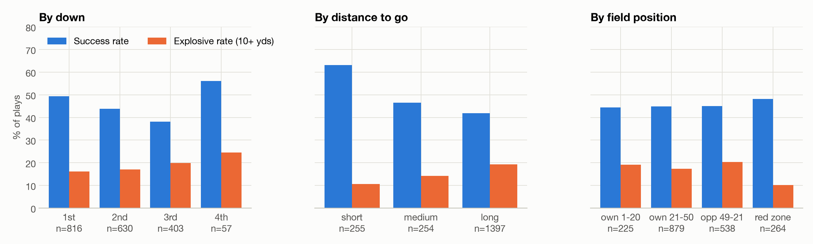
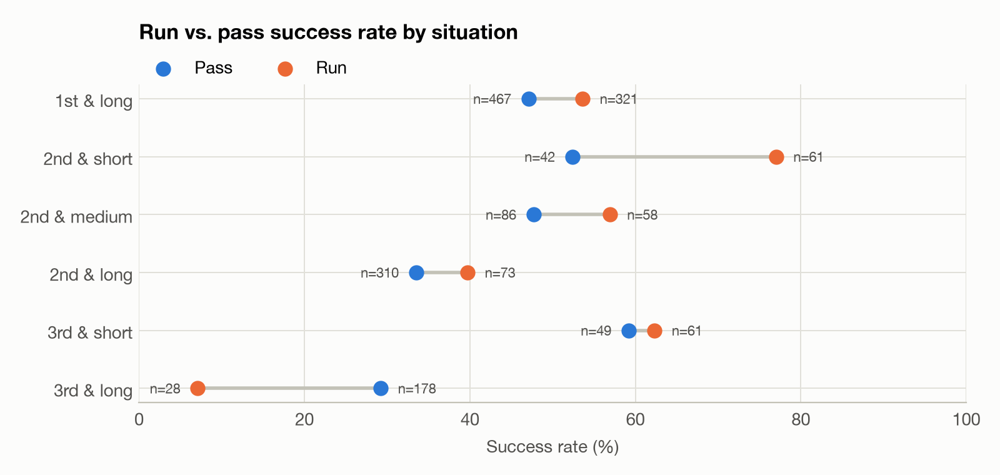
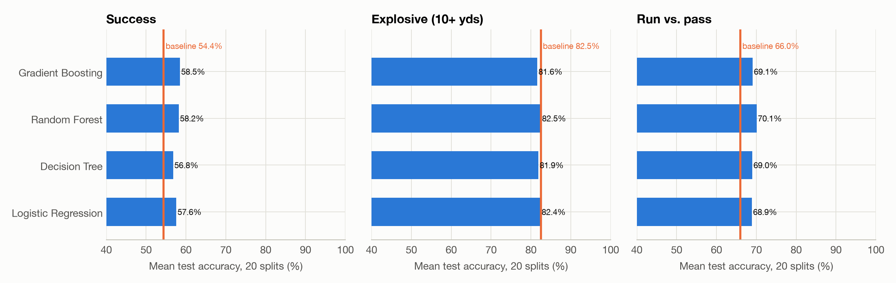

\newpage

## Introduction
As a computer science major and NCAA Division 3 football player, I have always noticed the lack of data analytics within the sport. While teams at the NFL and Division I level use plenty, there is a lack at the lower levels of football. At our level, plays are handwritten onto a clipboard as they happen in a game, and coaches have to manually log everything after the fact, while confirming that what was written is true based on the film. Putting all of this time towards inputting the data does not leave room for data analysis, and getting further insights. With so much nuance going into what happens on the field, it would be beneficial for more analytics to be done. With so many past games logged with lots of data, there are a lot of numbers there that would likely help teams be more successful. 

There is extensive work that has been done at the higher levels. @blinkoff2020 ran a study where they predicted fourth down conversions for Power 5 teams, which are the best Division I football teams in the nation. @simikic2024 utilized machine learning algorithms to predict offensive play calls. However, little of this work has been done at the Division III level.

The data used in this project comes from the Pomona-Pitzer football team, consisting of games within their league since 2019. 

Through these analyses, I want to explore two main questions:

1. What formations or play types succeed in which situations?

2. Can a play's result be predicted from the situation and past results?

Success in football is difficult to measure, as there are a number of things an offense hopes to achieve. Did a play result in a first down, a touchdown, or a big play, or did the offense simply gain five yards and keep progress going as it should? For the purposes of this study there are more than one definition of success, based on the context of what is being measured. In some cases, a successful play can just be a gain of four to five yards, or success can be measured as an explosive play, of 10 or more yards. 

With my findings, coaches can see what has worked for them historically and what has not. It can help them figure out what types of plays they should run more often, and what to run in specific situations. Part of why data analytics may have been lacking at this level of football is ease of use. Coaches need something easy to use, and @goudsmit2022 designed a dashboard based on what coaches wanted to see.

The rest of the paper covers further background on the topic and related work. It then goes into the data, and exploratory analysis of that data. It then presents the methods and results, and ends with a conclusion.

## Background and Related Work
In order to understand this work, it is important that the reader understands several football terms that come up throughout this paper. Everytime an offense has the ball, they get four attempts to gain ten yards. Every time they get ten yards, they get four more tries. These are called downs, and go first down, second down, third down, and fourth down. In most situations, the offense only uses three downs, and on the fourth, punt the ball back to the other team to put the opposing offense in a less favorable position. The goal is to never have to punt, and continue to get first downs. Once ten yards is gained on any of the downs, the downs reset to first down. This includes getting 10+ yards on first down, you just get another first down right after. Each down comes with a distance, such as "3rd and 4", where the number of yards is the distance to get a first down. As an offense moves down the field, the yard line that they are on changes. Based on their spot on the field, which is measured by yard line, the way an offense runs plays changes. On each play an offense runs they line up differently, placing wide receivers, running backs, and tight ends in different spots. These different ways of lining up are called formations. The players the offense put on the field can also change. There can be 1 running back and four receivers, two running backs, etc. These different groupings of players are called personnel. Each down, the offense also runs a play. The offense can either run or pass the ball, and it is based on the situation of the game. Different plays get run based on personnel and formations, which allows for a very broad category. Football offenses have a large variety of play calls that they use.

Given how much nuance there is in football, it is hard to have one concrete definition of success. Getting four yards on a first and 10 is a good play, but four yards on third and 5 fails to get the offense a new set of downs. Thus, raw yards is not a good metric for what makes a play successful. There is no single agreed definition of a successful play. @teich2016 show that if a play is successful only if you get a first down out of it, then a negative play and a 9 yard gain on first and 10 are equal. Instead, they use a measure that dpeends on the down since a failure on third or fourth down means that the offense is going to lose posession of the ball. A common convention of success, and how this project defines a successful play, is one that gains 40% of the yards needed on first down, 60% on second down, and 100% on third and fourth. These are a convention, because each one sets up a down that is much more favorable to the offense. These are numbers that would likely lead to a successful drive. Another useful metric is EPA, as modeled by @yurko2019, which is a standard in the NFL. Unfortunately, calculating EPA requires far more data than a Division III team has, which is why this project uses this success rate and explosive plays of 10 or more yards. 

Most prior work in this field predicts the play type (run or pass). @fernandes2020 uses 130,344 plays over four NFL seasons, and created a neural network that reached 75.3% accuracy. Trees that were built in this study for individual teams ranged from 64.7% to 82.5%. @otting2021 use hidden Markov models to treat play calls as a time series and got 71.6% accuracy from a sample of the 2018 season. @simikic2024 used about 400,000 NFL plays to try and predict run or pass, using data from 2002 to 2012. There are some studies that try and predict the result of a play, such as @teich2016 which test machine learning methods to predict outcomes. @blinkoff2020 made a model of fourth down conversion in NCAA Division I Power 5 games from 2015 to 2018. They used logistic regression with a random effect for each team, and found that significant predictors were distance to go, run or pass, and the week of the season. This shows that simple models can help with specific decisions.

Models like these are only helpful if coaches actually want to use them. @goudsmit2022 built a dashboard for coaches, working with coaches, to tailor it to their preferences. Coaches will often adopt a tool if they see its value and it fits routines they already have in their workflow. Division III coaches already spend a lot of time logging data by hand, and have little time to learn a new tool. Given that prior work uses largely available NFL or Division I data, the upside of the model discusses in this paper is that it is beneficial to one Division III team that logs data by hand. 

## Data
The data utilized for this project comes from the Pomona-Pitzer football team, an NCAA Division III team participating in the SCIAC conference. The main data source is the play by play data that the team logs during each game. Since Pomona-Pitzer faces the same SCIAC opponents each year, I used data from each of our games against these teams dating back to 2019. The data is updated week to week, using data from games as they are played in the 2026 season. All the data is against SCIAC opponents only, since teams outside of the conference are only played a limited number of times when dating back to 2021. The Pomona-Pitzer data on Hudl dates back over 10 years, but since the offensive play calls can change over time I restricted the time period within seven seasons to keep things as accurate to our modern play calling as possible. At the NCAA Division III level, football teams average about 60 to 80 offensive plays per game, each of which is a row in the data. 

Unlike higher level football, like Division I or NFL, to get this data an injured player or assistant coach on the sideline holds a paper and clipboard, and writes down information about the plays as they get called. The information they log includes the play call that the offensive coordinator makes, as well as the formation that the play comes from. Generally, this task is given to a trustworthy player who has a strong understanding of the game because they will also note down the formation that the defense is in. This does create room for error due to a human failing to correctly hear the play call, or writing down the wrong play. Since they also write the personnel and formation, if they see or hear something wrong this can also create an issue. The defensive alignment is rarely incorrect because a coach will review the film and make changes as they watch. 

While the game is being played, it is filmed for the team to review the results of the game. This film is uploaded to a platform called Hudl, which is a sports video analysis platform. A vast majority of football teams at all levels throughout the country, along with other sports, use Hudl. A service that Hudl provides is called Hudl Assist, which teams have to pay extra for. With this feature, Hudl will tag the down, distance, field position, and play outcome for teams that buy it. The main view of Hudl has the film on the top half of the screen, and a spreadsheet of information about each play below it. 

Each play includes a number of different types of variables. There are numeric variables, such as the down, distance, yard line, and the yards gained or lost on a play. Categorical variables include the offensive formation, play type, play call, and the defensive alignment. There is also metadata such as the quarter that the play took place in, which is important in the context of football.

Various games will have different data, with extra columns added for more details or slightly different column names. For example the offensive formation can come in as "Off_form" or as "Offensive Formation", just based on how the coach tagged it that play. These name mismatches are something that I handled, along with null values on some plays. Timeouts, penalties, and kneels are logged just like the other plays, which had to be thrown out because they have lots of null values, or will present a negative or positive gain that did not have to do with the actual play call itself.

## Ethics
When dealing with sports data, the primary ethical concern is from a lens of competition. The data that I have been using contains plays in the order they happened in a game, along with the exact play calls in the form of Pomona-Pitzer terminology. If someone were to get their hands on the data, know what game each one comes from, and have access to the film, they would be able to match up each play to each play call and learn what each thing is. Essentially, they would be able to learn Pomona-Pitzer's entire playbook. If Pomona-Pitzer knew about it, they would have to spend months trying to make a brand new playbook, and if they did not know about their playbook getting leaked, they would struggle to win games. Teams would know what was coming based off their play calls, and thus be able to know exactly what the offense is about to do and put their defense in the best position possible to stop it. The data that powers this project would be a gold mine for any opposing team, and almost guarantee them a win against Pomona-Pitzer when they play them. To address this, I have not published any of my code or datasets online. I currently have my GitHub public, but will private it when it is time to push all the code and datasets along with it. Within the paper there will be no connection to what each offensive formation looks like, and I will change the names of play calls to make it all anonymous. Since I will be covering data relate to plays that are runs vs. passes, its important to give fake names to each play so there is no correlation. 

As a member of the Pomona-Pitzer football team, this is data I am allowed to access and use. My coaching staff also approved this project, so there are no questions about whether or not I am allowed to use these CSVs for analysis.

Another challenge with sports data is player privacy. None of the data in the CSVs that I have use any personal identifiers, and include only general information about the offense and the plays it ran. It does not say who carried the ball, who had the gain of yardage, etc. so there is no issue with player privacy here.

Since this data is hand transcribed, there is the potential for errors. With a limited number of games, there can be misleading patterns and statistics, so the model's predictions are purely based on probability, and should be used only as support for offensive decision making.

## Exploratory Data Analysis
The dataset came out to 31 games against 5 SCIAC opponents. They range from the 2019 season all the way to the 2026 season. Due to COVID, there was no 2020 season. In these 31 games, there were 1,906 Pomona-Pitzer offensive plays ran, excluding plays that resulted in penalties or were kneels. Since play calls and formations could change over the years, play calls were grouped into concepts and formations were grouped based on their name, not direction. For example, Formation left and formation right are the same formation, just on different sides of the field. 

The first analysis was done on play selection and general outcomes. Pomona-Pitzer passed on 65.9% of plays since 2019. The team passed on 58.2% of plays in 2024, and saw a jump to 79.1% in 2025. The median gain is three yards across runs and passes, with a standard deviation of 9.7 for passes and 5.9 for runs. Using the metric for success defined in the background portion of the paper, the Pomona-Pitzer offense had a 45.3% success rate over the time period. Using the explosive rate also defined in the background portion of the paper, plays that gained 10+ yards, there was 17.5% explosive rate. Runs saw more success than passes based on this metric than passes, 52.6% versus 41.6%, while passes saw a nearly double explosive rate (20.9% versus 10.8%).

I also conducted analysis on various situations. Since offensive plays heavily depend on how many yards it takes to get a first down, I created three groups of distances. The first is short, which is 1 to 3 yards, then medium, which is 4 to 6 yards, and then long which is 7 or more. The field is also split into four zones, going from close to the teams own endzone, to the other end of the field. Most of the analysis found metrics that made sense, such as the success metric falling and the explosive rate rising when distance grows (@fig-rates). Field position had little effect on success. The lowest success rate, which was backed up inside your own 20 yard line, was 44.4%, while the highest was only a 3.7% increase to 48.1% in the red zone (within opponents 20 yard line). Fourth down success was 56.1%, which is relatively high. There is a higher chance of converting a fourth than not, based on Pomona-Pitzer offensive history. 

{#fig-rates}

## Methods
I used different methods to approach each of the research questions. The first looked into formations and play types, and their respective success in various situations. Each formation or play concept was comapred with every other play call in the same situation. For example, a formation on second and long was compared with all other plays and formations also fun on second and long. Due to a small number of plays, I had to find a test that would stay accurate with small samples. I chose to use Fisher's exact test, which calculates how likely it is that two groups differ in success rate by as much as they do purely by chance @mcclenaghan2025. To account for low usage of certain formations and plays, formations had to be used at least 15 times and plays had to be run at least 20 times. Comparing every formation in play in many different situations meant that I had to run over 150 tests. With that many test being run, there was a chance that luck would make some comparisons seem significant. To account for this, I used the Benjamini and Hochberg correction, which adjusts the results of many tests run at once so that only a small share of the results called findings are expected to be false alarms @raviv2017. The test's adjusted result is called a q value, which I set to be .10. This means that about one in ten findings could be a false alarm.

The second research question asked about play prediction. I used several models to attempt to predict whether a play will be successful or explosive. In order to do this, the models are fed previous play's situation, type, result, and how often the team ran it so far that game. I wanted to experiment with situation, so I kept the actual play call out of it and ran models separately that had knowledge of what the play call was. I tested four models. Logistic regression is the simplest, and estimates the probability of a play's success by weighing the inputs. A decision tree predicts a result by asking a series of yes or no questions about the play, such as whether it was second down or whether the distance to gain was more than 5 yards. A random forest builds hundreds of decision trees, where each have a different random sample of plays. The random forest averages their predictions. Gradient boosting also uses decision trees, but builds a new tree one at a time focusing on the plays that earlier trees got wrong. Studies like @blinkoff2020 and @fernandes2020 use logistic regression and decision trees because they are easy to interpret. Random forest and gradient boosting are more complex but can pick up more complex patterns. Every model was compared against a baseline that just always guessed the most common outcome. A predictive model is only better if it is able to beat that. I used a 80/20 train test split, meaning that all models were fed 80% of the play data with all the information about the play, while 20% were kept for testing. I also used AUC alongside accuracy which shows how well a model actually learned something. 0.5 was just a 50/50 guess, while 1.0 was perfect. This accounts for issues such as predicting that every play is not explosive, which would gain an accruacy score of 82.5% since only 17.5% of plays are explosive.

## Results and Findings
The results are organized by research question. The frist part covers which formations and play types succeeeded in which situations using the comparisons discussed in methods. The second part. covers how well the models were able to predict a play result, measured against he baseline. 

A lot of the basic findings align with the situation (@fig-runpass). On second and short, runs succeeded 77% of the time, while passes only succeeded 52.4% of the time. Third and long saw 29.2% of passes succeed, while runs only succeeded 7.1% of the time. For the third and long scenarios, a lot of the runs were likely not meant to succeed and were calls that were meant to be safe. No other situations showed a significant difference between running and passing or had too few plays. 

{#fig-runpass}

No statistics showed any significance that one formation or play concept was better than all the others. There was a run play that succeeded 79.2% of the time in red zone, as compared to 45% for other plays. For the purpose of this paper I will call this play "Arkansas", to maintain data privacy for the Pomona-Pitzer football team. Similarily, a pass play that I will call "Texas" succeeded 39.5% of the time on third and long as compared to 22.7% for other plays.

The best model for play success prediction was gradient boosting with the play call included. This model reached 58.5% accuracy, but the models were only slightly better than guessing (@fig-models). The baseline for guessing that a play would not be successful was 54.4%, so the model was only four percentage points better. It had an AUC of 0.61, which is closer to the 0.5 coin flip than it was to being a perfect model at 1.0. This means the model picked up real information about which plays might succeed, but not enough to be extremely useful. The models did not see a huge difference with the play calls, as the best model without the play calls had a accuracy rate of 57%. The most important inputs for the models were distance and previous play's gains. Explosive plays did not see any model beat its 82.5% baseline. For predicting run versus pass, the random forest reached 70.1% accuracy. This barely beat out the baseline, where guessing pass for every play had an accuracy of 66%. The biggest input here was how much the team had run that game. All models were within a few points of eachother, and the variation between splits was not large. 

{#fig-models}

## Discussion and Conclusion
The most usable takeaways for coaches delt with what type of play to run in certain situations. There was no formation or play concept that proved to be better in any situation, except for the two mentioned prior. The success of a play was only slightly predictable, likely as a result of the data not capturing the actual execution of each play. Explosive plays were not at all predictable. The play type was more predicatable than the result, with a run versus pass prediction being correct 70% of the time. There were limitations, with the main one being the size of the data. It was small, with only 1,906 plays. There is room for error in the data, given that it was logged by hand on the sideline. As Pomona-Pitzer continues to play game, more and more data will be able to be added to the dataset as long as the offense stays the same. Although prediction was unsuccessful, a simple dashboard of success rates based on situation would still provide new insight to coaches. Simple analytics can point coaches toward better decisions, even with hand logged data for a single Division III team. 

\newpage

## Bibliography
:::{#refs}
:::